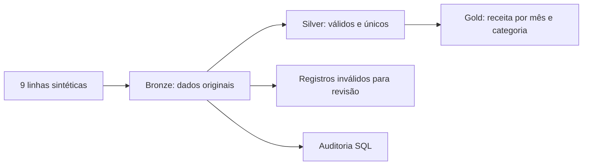

# Engenharia de Dados com Databricks

Portfólio de estudo de **Igor Gomes**, em transição para Engenharia de Dados.

**Status: início do desenvolvimento.** O código inicial foi preparado com apoio de IA para estudo acompanhado. Ainda não foi executado no Databricks; não há resultados de produção ou experiência profissional implícita.

## Projetos

| Projeto | Pergunta | Entrega inicial |
|---|---|---|
| [01 — Vendas](projetos/01-vendas/README.md) | Quanto vendemos por categoria e mês? | Notebook com dados sintéticos, camadas Bronze/Silver/Gold e verificações |
| [02 — Qualidade](projetos/02-qualidade/README.md) | Quais registros precisam de correção? | Notebook de auditoria SQL e roteiro para evoluir regras |

## Começar juntos

1. Leia o [roteiro de estudo](docs/ROTEIRO.md).
2. No seu workspace Databricks, crie uma pasta de estudo e importe `projetos/01-vendas/01_pipeline.py` como notebook Python (formato source).
3. Selecione um catálogo em que você possa criar schemas. O notebook usa o catálogo atual e cria apenas o schema `portfolio_igor_vendas`.
4. Leia a primeira célula antes de executar. Execute uma célula por vez e anote suas dúvidas.
5. Compare as contagens com os valores esperados documentados. Salve evidências somente depois da execução real.
6. Importe o segundo notebook e execute depois do primeiro, no mesmo catálogo.

Não precisa de uma conta Azure paga nem de acesso a dados externos para estes exemplos. Use seu workspace disponível; a [Free Edition](https://docs.databricks.com/aws/en/getting-started/free-edition) tem cotas e limitações. Nenhum recurso de nuvem foi provisionado por este repositório.

## Arquitetura didática

Os dados são fictícios e não representam pessoas ou instituições. Bronze preserva duplicatas; Silver filtra inválidos e remove duplicatas idênticas. Uma evolução futura deverá tratar IDs repetidos com conteúdo divergente.

## Ferramentas e escopo

Databricks, Python, PySpark, Spark SQL e tabelas Delta. Sem tokens, segredos, serviços externos ou agendamentos. A escrita usa `overwrite` somente nas tabelas de laboratório explicitamente nomeadas; cada execução substitui os dados de exemplo dessas tabelas. Troque o schema se já houver conteúdo seu com esses nomes.

## Validação

- Sintaxe dos notebooks Python verificada localmente.
- Resultados numéricos conferidos com cálculo independente nos dados fixos.
- Execução Spark, criação das tabelas Delta e consultas no Databricks: **pendentes**.
- Dashboards e ingestão incremental: **planejados**, não implementados.

## Git na prática

Clone o repositório pelo GitHub Desktop e crie uma branch como `estudo/primeira-execucao`. Faça uma pequena mudança, revise o diff, crie um commit descritivo e abra um pull request. Nunca versione senhas ou tokens. Veja `.gitignore`.

## Referências

- [DataFrames no Databricks](https://docs.databricks.com/aws/en/getting-started/dataframes)
- [Limitações da Free Edition](https://docs.databricks.com/aws/en/getting-started/free-edition-limitations)
- [Meu LinkedIn](https://www.linkedin.com/in/igor-gomes-534b35290/)
